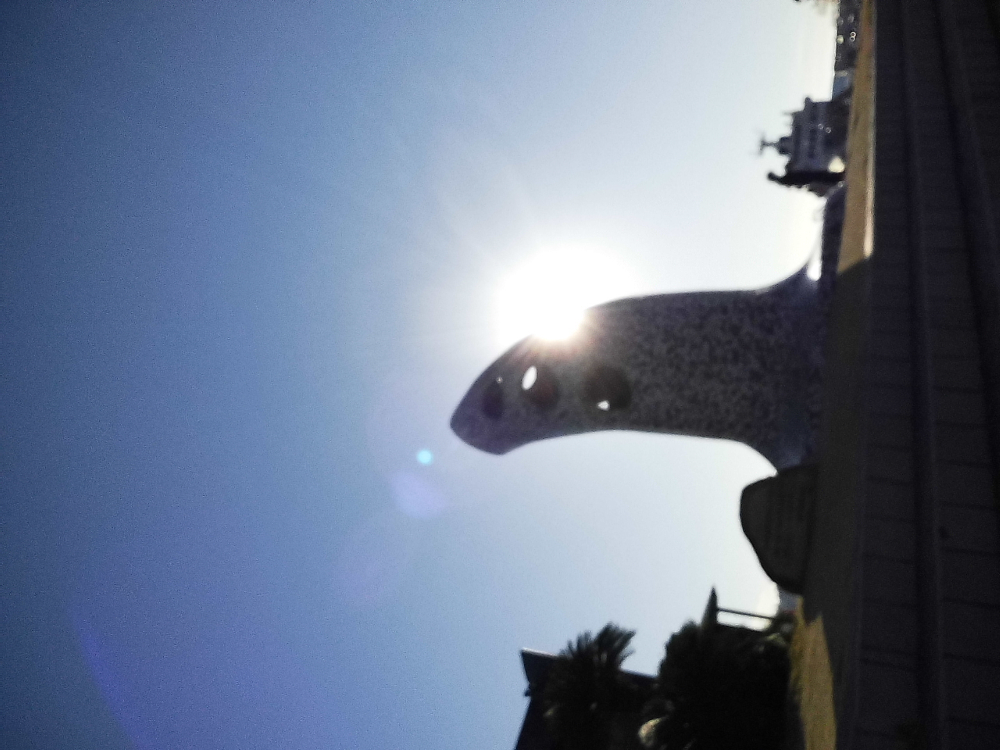

--
はじめての写真記録
date: 2026-11-09
---
思いつきで個人写真ブログを始めました。
38歳の男です。
2027年はこのブログを中心に、
自分自身の生活、AIには出せない文章、感性に満ちたスナップ写真を
アップロードしていければと思います。

2026年11月13日　
早朝の神戸を散歩した。
メリケンパークには、愛犬と戯れる人、スターバックスでコーヒーを嗜む人、
各々が好きな時間を過ごしていた。
自分自身は考え事をしながら海沿いを歩き、来年は何を始めようか、
どこに行って何をしようかなど、考えを巡らせた。
しかし、結論に至らないまま、帰路についた。
今年も残り1ヶ月半、あっという間の1年であった。

スターバックス裏のオブジェ
